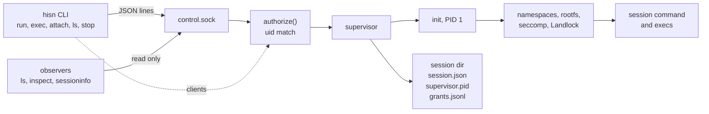

<p align="center">
  
</p>

# hisn

hisn is a Linux sandbox for running agents and their tools in isolated, named, lease-managed sessions: a single binary, no daemon, no root.

[](https://github.com/treeol/hisn/actions/workflows/ci.yml)
[](https://github.com/treeol/hisn/releases)
[](Cargo.toml)
[](LICENSE)

hisn runs a command in a private view of the machine. The command sees its
working directory at the same path as on the host, a read-only toolchain, and
private `$HOME`, `/tmp` and `/run`. Paths outside the view are absent
(`ENOENT`), not denied. Access beyond that exists only when granted, and every
grant ends with the session.

## What it does

- **Namespace isolation with a pinned rootfs.** Unprivileged user, mount, pid,
  ipc and uts namespaces, `pivot_root` into an empty tmpfs, seccomp, Landlock,
  and an optional read-only rootfs imported once with `hisn rootfs import`.
- **Named sessions with lifecycle state and leases.** `--name`, a recorded
  state (`creating`, `running`, `stopping`, `stopped`, `crashed`), and an
  optional `idle_timeout` after which an unused session stops.
- **Attach and exec with client identity.** Every request carries a client
  record (uid and pid from `SO_PEERCRED`, a label); one `authorize()` function
  gates every operation.
- **Event-driven start and stop.** `run --detach` returns when the control
  socket accepts; `stop` waits on a pidfd. No fixed polling interval.
- **Audit log and archival.** An append-only `grants.jsonl` per session,
  archived to `$XDG_STATE_HOME/hisn/audit/` when the session is pruned.
- **Machine-readable state.** `hisn ls --json` (schema `hisn-ls/v2`) for
  drivers such as Wakil.

## Architecture



- CLI: `src/cli.rs` (clap definitions), `src/main.rs`, `src/execcli.rs`, `src/attach.rs`.
- Control socket and protocol: `src/control.rs`; authorization: `src/authz.rs`.
- Supervisor: `src/supervisor.rs`; stop and idle expiry: `src/lifecycle.rs`.
- Session directory and metadata: `src/session.rs`, `src/sessionmeta.rs`, `src/registry.rs` (names).
- Sandbox: `src/init.rs`, `src/rootfs.rs`, `src/mounts.rs`, `src/seccomp.rs`, `src/landlock.rs`, `src/env.rs`, `src/exec.rs`.
- Policy and profiles: `src/policy.rs`, `src/profile.rs`; rootfs store: `src/rootfs_store.rs`, `src/rootfs_import.rs`.

## Quickstart

Install a release binary (Linux x86_64; use `hisn-aarch64-linux-gnu` on aarch64):

```sh
curl -fsSLO https://github.com/treeol/hisn/releases/latest/download/hisn-x86_64-linux-gnu
curl -fsSLO https://github.com/treeol/hisn/releases/latest/download/SHA256SUMS
sha256sum -c SHA256SUMS --ignore-missing
install -m 0755 hisn-x86_64-linux-gnu ~/.local/bin/hisn
```

Or build from source with `cargo install --path . --locked`. Then:

```sh
hisn check                                              # does this host qualify?
hisn rootfs import dev --from-image debian:12           # one image; needs docker (or use --from-tar FILE)
hisn run --name demo --detach --rootfs-path "$(hisn rootfs path dev)"
                                                        # prints "<id> demo ready"
hisn exec --session demo -- uname -a                    # a command in the session
hisn attach --session demo                              # interactive shell; Ctrl-] d detaches
hisn ls                                                 # NAME ID STATE CWD ROOTFS NET AGE CLIENTS LEASE
hisn stop --session demo                                # state stopped, directory kept
hisn ls --prune --name-prefix demo                      # archive and remove stopped demo* sessions
```

The rootfs step is optional: without `--rootfs-path` the session uses the host
toolchain read-only. `hisn run -- CMD` runs a single command and exits with its
status. Add `-v` for logs on stderr.

hisn needs kernel 5.12 or newer with unprivileged user namespaces, Landlock and
seccomp. `hisn check` reports what is missing (exit 2; `--json` for a report).

## Security model

**Isolated.** The sandbox root is an empty tmpfs entered with `pivot_root`; only
an allowlist of bind mounts exists. Capabilities are dropped, `no_new_privs` is
set, seccomp denies `mount`, `unshare`, `setns`, `ptrace`, `bpf`, `io_uring`
and related calls, and Landlock restricts writes as a second layer. The
environment is rebuilt from scratch; values declared with `--env` or
`--env-file` form a session snapshot that a request cannot override
(`E_ENV_LOCKED`). The network is `none` (loopback only) by default; `host`
needs Landlock abstract-socket scoping or an explicit flag.

**Authorized.** The control socket is mode 0600 and refuses any peer inside the
sandbox's pid namespace. `authorize()` allows a request only when the client
uid equals the session owner's uid. Observers (`ls`, `inspect`, `sessioninfo`)
are never registered as clients and never keep a session alive.

**Logged.** Operations are recorded in the session's `grants.jsonl` with the
client label, a sequence number and the authorization result. Pruning archives
the log and the final `session.json` before removing the directory.

**Not provided.** hisn is not a VM: the sandbox shares the host kernel, and a
kernel vulnerability is outside the model. It does not filter network traffic;
under `network = "host"` the session has the host's network. It does not limit
memory or cpu beyond rlimits. An egress proxy and cgroup v2 limits are planned,
not yet scheduled ([roadmap](docs/ROADMAP.md)).

Depth: [DESIGN](docs/DESIGN.md), the [ADR index](docs/adr/README.md),
[SECURITY](SECURITY.md).

## Using hisn from a program

The contract is described in one place:
[Driving hisn from a program](docs/sessions.md#driving-hisn-from-a-program).
In short:

- `hisn run --name N --detach` prints `<id> <name|-> ready` and exits 0 when
  the session is ready; a failed start exits 125.
- Exit codes: the command's status, `128+N` for signal `N`, `125` for a hisn
  error, `126` not executable, `127` not found.
- `hisn ls --json` returns `{"schema":"hisn-ls/v2","sessions":[...]}` with live
  `clients` and `execs`; fields are only added.
- The `sessioninfo` control op supplies that live view; observers do not count
  as clients.

[Wakil](docs/WAKIL-INTEGRATION.md) is the reference driver.

## Status

hisn 0.4.1. Release notes: [docs/releases/v0.4.1.md](docs/releases/v0.4.1.md);
history in [CHANGELOG](CHANGELOG.md). CI runs the leak suite on Ubuntu 22.04
and 24.04 (x86_64); aarch64 is checked by clippy only. Planned, not yet
scheduled: an egress proxy, cgroup v2 limits, and a pty allocated inside the
session for attach ([ROADMAP](docs/ROADMAP.md)).

## Development

```sh
cargo build
cargo test                 # unit tests
make lint                  # rustfmt and clippy -D warnings
make leaktest              # the leak suite; needs unprivileged user namespaces
```

The leak suite (`tests/leak/run.sh`, ids listed in `tests/leak/MANIFEST`) runs
probes from inside a real session: it tries to stat host paths, read secrets,
escape through `/proc`, use denied syscalls, reach sibling sessions, use revoked
grants and follow planted symlinks. It exits non-zero on any `FAIL`, and on a
host without user namespaces it exits 77 and reports nothing. `SKIP` and `WEAK`
lines are never counted as passes. `HISN_TEST_ROOTFS` points it at a rootfs for
the rootfs checks. See [CONTRIBUTING](CONTRIBUTING.md) and the
[documentation index](docs/README.md).

## License

[Apache-2.0](LICENSE)
