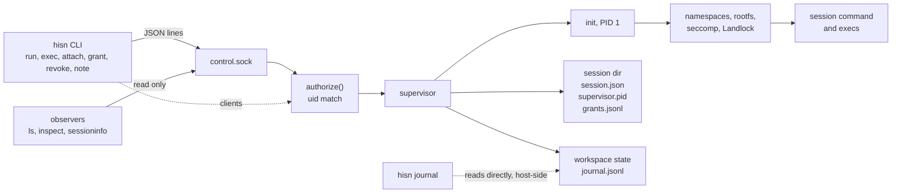

<p align="center">
  
</p>

# hisn

hisn is a Linux sandbox for running agents and their tools. It runs each
workload in an isolated, named session and keeps a record of what the session
did. It is a single binary and needs no daemon and no root.

[](https://github.com/treeol/hisn/actions/workflows/ci.yml)
[](https://github.com/treeol/hisn/releases)
[](Cargo.toml)
[](LICENSE)

A command started by hisn sees a private view of the machine: its working
directory at the same path as on the host, a read-only toolchain, and private
`$HOME`, `/tmp` and `/run`. Paths outside this view do not exist for the
command (`ENOENT`); they are not merely denied. Access beyond the view exists
only when it is granted, and every grant ends with the session.

## Features

- **Isolation.** Unprivileged user, mount, pid, ipc and uts namespaces,
  `pivot_root` into an empty tmpfs, seccomp and Landlock. A read-only rootfs
  can be imported once with `hisn rootfs import` and reused by every session.
- **Named sessions.** A session has a name, a recorded state (`creating`,
  `running`, `stopping`, `stopped`, `crashed`) and an optional `idle_timeout`
  after which an unused session stops.
- **Exec and attach.** Commands and interactive shells run inside a running
  session. Every request carries a client record (uid and pid from
  `SO_PEERCRED`, and a label), and one `authorize()` function decides every
  operation.
- **Grants.** `hisn grant --session S PATH` attaches a host path inside the
  running session's mount namespace, read-only unless `--rw` is set (grants
  given at `run` time use `--grant PATH[:ro|rw]`, default `ro`). `hisn
  revoke` detaches it; without `--hard` the answer only guarantees it is no
  longer visible (`lookup`), with `--hard` it also kills every sandbox
  process except init. Grants never outlive the session: they live in the
  sandbox mount namespace, not in any stored table.
- **Workspace journal.** hisn records what happens in a workspace: session
  start and stop, each command with its command line, exit code and duration,
  grants and revokes, and notes. `hisn journal` reads the record back, and
  `hisn note` adds a note to it.
- **Seats.** A workspace can name its clients: `hisn seat add NAME --role
  owner|member|observer` creates a seat with a one-time credential (stored
  as a hash, valid in every session of the workspace). Members may exec and
  observe but may not grant, revoke, kill or manage seats; observers may
  only observe. Under one Unix user a seat is attribution and a guard
  against mistakes, not a security boundary.
- **Git change report.** When a session stops, hisn records whether
  `.git/hooks` or `.git/config` changed during the session and flags
  configuration keys that can run programs. This is a report; nothing is
  blocked.
- **Audit log.** Each session has an append-only `grants.jsonl`, archived to
  `$XDG_STATE_HOME/hisn/audit/` when the session is pruned.
- **Documented interface.** `hisn ls --json` (schema `hisn-ls/v2`) reports
  session state, and the control socket protocol is specified in
  [docs/CONTROL-PROTOCOL.md](docs/CONTROL-PROTOCOL.md).

## Architecture



- CLI: `src/cli.rs` (clap definitions), `src/main.rs`, `src/execcli.rs`, `src/attach.rs`.
- Control socket and protocol: `src/control.rs`; authorization: `src/authz.rs`.
- Supervisor: `src/supervisor.rs`; stop and idle expiry: `src/lifecycle.rs`.
- Session directory and metadata: `src/session.rs`, `src/sessionmeta.rs`, `src/registry.rs` (names).
- `stop` command and idle expiry: `src/lifecycle.rs` (with the supervisor).
- Workspace and journal: `src/workspace.rs`, `src/journal.rs`; git change report: `src/gitreport.rs`.
- Sandbox: `src/init.rs`, `src/rootfs.rs`, `src/mounts.rs`, `src/seccomp.rs`, `src/landlock.rs`, `src/env.rs`, `src/exec.rs`.
- Policy and profiles: `src/policy.rs`, `src/profile.rs`; rootfs store: `src/rootfs_store.rs`, `src/rootfs_import.rs`.
- Secrets plumbing (SSH agent proxy, services): `src/services.rs`, `src/ssh_agent.rs`.
- The remaining modules are not the Architecture story: `src/alias.rs`,
  `src/grant.rs`, `src/sys.rs`, `src/sig.rs`, `src/check.rs` — see
  `src/lib.rs` for the full list.

## Quickstart

Install a release binary (Linux x86_64; use `hisn-aarch64-linux-gnu` on aarch64):

```sh
curl -fsSLO https://github.com/treeol/hisn/releases/latest/download/hisn-x86_64-linux-gnu
curl -fsSLO https://github.com/treeol/hisn/releases/latest/download/SHA256SUMS
sha256sum -c SHA256SUMS --ignore-missing
install -m 0755 hisn-x86_64-linux-gnu ~/.local/bin/hisn
```

Or build from source with `cargo install --path . --locked`. Then:

```sh
hisn check                                              # check that this host can run hisn
hisn rootfs import dev --from-image debian:12           # import one image; needs docker (or use --from-tar FILE)
hisn run --name demo --detach --rootfs-path "$(hisn rootfs path dev)"
                                                        # prints "<id> demo ready"
hisn exec --session demo -- uname -a                    # run a command in the session
hisn attach --session demo                              # interactive shell; Ctrl-] d detaches
hisn note --session demo "first test run"               # add a note to the journal
hisn journal --session demo --last 10                   # show the last 10 events
hisn ls                                                 # NAME ID STATE CWD ROOTFS NET AGE CLIENTS LEASE
hisn stop --session demo                                # state stopped, directory kept
hisn ls --prune --name-prefix demo                      # archive and remove stopped demo* sessions
hisn ls --prune --name-prefix demo --dry-run            # list what would be pruned, remove nothing
```

The rootfs step is optional: without `--rootfs-path` the session uses the host
toolchain read-only. `hisn run -- CMD` runs a single command and exits with its
status. Add `-v` for logs on stderr.

hisn needs kernel 5.12 or newer with unprivileged user namespaces, Landlock and
seccomp. `hisn check` reports what is missing (exit 2; `--json` for a report).

## Workspace journal

A workspace is the unit that sessions share. By default it is derived from the
session's canonical working directory, so all sessions started in one
directory write to one journal. `hisn run --workspace NAME` selects a
workspace by name instead. State lives in
`$XDG_STATE_HOME/hisn/workspaces/<id>/` (dir `0700`); the journal is
`journal.jsonl` (0600, one JSON object per line, 64 MiB rotation; rotated
files are kept and still read). Once per workspace, whatever the
session's network mode, the oldest rotated files are deleted once the
journal exceeds 256 MiB in more than four files (4 x 64 MiB; the newest
rotated file and the current file are never deleted). Each deletion
writes one `journal/pruned` record naming the deleted files, their
total bytes and their count.

```sh
hisn note --session demo "halfway through the migration"   # verbatim, at most 8 KiB
hisn journal --session demo --last 10                       # newest 10 events, one compact line each
hisn journal --kind exec --since 2026-11-07T12:00:00Z       # exec events since a timestamp (RFC 3339 UTC, Z)
hisn journal --json                                          # exact records, one per line
```

The default output is one line per event. A command, its result and its exit
are merged into a single line with the command line, exit code and duration.
`--last N` counts displayed events; with `--json` it counts raw records.
`--since` must be an RFC 3339 UTC timestamp ending in `Z`: an offset such as
`+02:00` is rejected, not silently parsed as UTC. `--session` accepts an id
or the name and resolves the workspace from the live session's `session.json`
first, then the persistent session markers, so the lookup works from any
directory and after the session has ended. The journal stores command lines
as given — see the security model.

The journal is a record, not a replay mechanism: nothing re-executes it and
it is not used to undo anything.

## Security model

**Isolated.** The sandbox root is an empty tmpfs entered with `pivot_root`; only
an allowlist of bind mounts exists. Capabilities are dropped, `no_new_privs` is
set, seccomp denies `mount`, `unshare`, `setns`, `ptrace`, `bpf`, `io_uring`
and related calls, and Landlock restricts writes as a second layer. The
environment is rebuilt from scratch; values declared with `--env` or
`--env-file` form a session snapshot that a request cannot override
(`E_ENV_LOCKED`). The network is `none` (loopback only) by default; `host`
needs Landlock abstract-socket scoping or an explicit flag. `open` (0.6.0)
keeps the empty network namespace and intercepts every `connect()` with
seccomp user notification: the supervisor makes outbound TCP connections
to public addresses on the session's behalf and records each decision in
the journal (at most 50 network records per second one by one; the rest
are counted in a summary). Private and link-local targets, UDP other
than DNS, and other address families are refused; names resolve through
a DNS responder in the supervisor. Limitations are listed in the
[0.6.0 release notes](docs/releases/v0.6.0.md).

**Authorized.** The control socket is mode 0600 and refuses any peer inside the
sandbox's pid namespace. `authorize()` allows a request only when the client
uid equals the session owner's uid. Observers (`ls`, `inspect`, `sessioninfo`)
are never registered as clients and never keep a session alive.

**Recorded.** Operations are recorded in the session's `grants.jsonl` with the
client label, a sequence number and the authorization result. The workspace
journal mirrors the same events (in journal shape) and adds exec argv
(capped at 512 bytes in total across all elements, verbatim, no pattern
redaction), exec exits (code or signal, cancelled/lost, duration), session
start and stop, notes and markers, lease expiry, and the git-change report.
Pruning archives the log and the final `session.json` before removing the
directory; the workspace journal survives pruning (it lives in the workspace
dir, not the session dir), and `hisn journal` reads it host-side for stopped
and pruned sessions. The journal is private to the user (directory mode 0700,
file mode 0600) and is not mounted into sessions. It stores command lines as
given, so it can contain secrets that were passed on a command line.

**Not provided.** hisn is not a VM: the sandbox shares the host kernel, and a
kernel vulnerability is outside the model. Under `network = "host"` the session
has the host's network; under `open` it can reach any public address over
TCP (there is no allowlist yet). It does not limit
memory or cpu beyond `setrlimit` limits. The journal and the git change report record
events; they do not prevent them. An egress proxy and cgroup v2 limits are
planned, not yet scheduled ([roadmap](docs/ROADMAP.md)).

Details: [DESIGN](docs/DESIGN.md), the [ADR index](docs/adr/README.md),
[SECURITY](SECURITY.md).

## Using hisn from a program

hisn is driven through its CLI and its control socket. Two documents describe
the contract:

- [Driving hisn from a program](docs/sessions.md#driving-hisn-from-a-program)
  describes the CLI contract.
- [docs/CONTROL-PROTOCOL.md](docs/CONTROL-PROTOCOL.md) specifies the control
  socket: framing, operations, error codes and versioning.

In short:

- `hisn run --name N --detach` prints `<id> <name|-> ready` and exits 0 when
  the session is ready; a failed start exits 125. The control protocol
  revision (this release: 3, absent on a pre-0.5.0 session) is recorded in
  `session.json` as `protocol_revision`.
- Exit codes: the command's status, `128+N` for signal `N`, `125` for a hisn
  error, `126` not executable, `127` not found.
- `hisn ls --json` returns `{"schema":"hisn-ls/v2","sessions":[...]}` with live
  `clients` and `execs`; fields are only added (0.5.0 adds `hisn_version`,
  `protocol_revision`, `workspace`, `journal` and `journal_failures`; 0.5.1
  adds `seats` — names and roles, never credentials).
- The `sessioninfo` control op supplies that live view; observers do not count
  as clients.
- `hisn journal --json` prints journal records unchanged, one per line.
- The control socket has 12 operations (8 existing plus `seat-add`,
  `seat-ls`, `seat-set-role` and `seat-revoke` at protocol revision 3); a
  0.4.3 client works unchanged against this release (six ops are
  byte-identical answers; `sessioninfo` and `inspect` gained additive
  fields).
- A seat credential travels in `client.seat_token` (protocol revision 3)
  and is taken from `HISN_SEAT_TOKEN` or `--seat-token-file`, never from a
  command-line argument; below revision 3 the CLI sends nothing and exits
  2 when a credential is configured.

[Wakil](docs/WAKIL-INTEGRATION.md) is the reference driver.

## Status

The current release is hisn 0.6.0. Release notes, including compatibility and
known limitations, are in [docs/releases/v0.6.0.md](docs/releases/v0.6.0.md);
earlier releases are in the [CHANGELOG](CHANGELOG.md).

CI runs the leak suite on Ubuntu 22.04 and 24.04 (x86_64). aarch64 and musl
targets are checked with clippy and a build only.

Planned, not yet scheduled: an egress proxy, cgroup v2 limits, and a pty
allocated inside the session for attach ([ROADMAP](docs/ROADMAP.md)).

## Development

```sh
cargo build
cargo test                 # unit tests
make lint                  # rustfmt and clippy -D warnings
make leaktest              # the leak suite; needs unprivileged user namespaces
make release-gate          # fmt, clippy, make check, make test, leak suite (pipe + pty)
```

`make release-gate` (`scripts/release-gate.sh`) runs, in order: `cargo fmt
--check`, `cargo clippy --all-targets -- -D warnings`, `make check` (`hisn
check`, host-capability report, exit 2 if a required capability is missing),
`make test` (cargo test + the L8 comparator self-tests), and the leak suite
twice (through a pipe, then on a pseudo-terminal via `script` when present).
It stops at the first failure; `HISN_TEST_ROOTFS` and `HISN_BIG_TESTS` are
passed through, and the rootfs and big-import leak cases skip when they are
not set.

The leak suite (`tests/leak/run.sh`, ids listed in `tests/leak/MANIFEST`) runs
probes from inside a real session: it tries to stat host paths, read secrets,
escape through `/proc`, use denied syscalls, reach sibling sessions, use revoked
grants and follow planted symlinks. It exits non-zero on any `FAIL`, and on a
host without user namespaces it exits 77 and reports nothing. `SKIP`
and `WEAK` lines are never counted as passes. `HISN_TEST_ROOTFS` points it at a rootfs for
the rootfs checks. See [CONTRIBUTING](CONTRIBUTING.md) and the
[documentation index](docs/README.md).

## License

[Apache-2.0](LICENSE)
