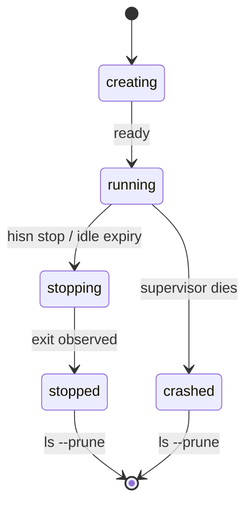

# Sessions and lifecycle (0.5.0)

This page describes one hisn session from creation to removal. It collects
what DESIGN §9, §20 and §20.1 and the code say in one place. Where they
differ, the code wins; the file and line references are in `src/session.rs`,
`src/sessionmeta.rs`, `src/supervisor.rs`, `src/lifecycle.rs`,
`src/control.rs`, `src/authz.rs` and `src/main.rs`.

> 0.5.0 additions: every session belongs to a **workspace** and its events are
> also recorded in the **workspace journal** (`journal.jsonl`,
> `$XDG_STATE_HOME/hisn/workspaces/<id>/`); the supervisor records its own
> version in `session.json` as `hisn_version`; and a **git-change report**
> (start/stop snapshots of `.git/hooks` and `.git/config`, journaled as one
> `git-change` record) is taken for every session whose cwd contains a `.git`
> directory. See the sections below.

## Names and ids

`hisn run` gives every session an id (random, or `--session-id`). `--name`
adds a human name, unique per user (letters, digits, `.`, `_`, `-`, no leading
`.`). Every `--session` argument accepts a name or an id. The name index is
`names.json` (with `names.lock`) in the per-user root `/tmp/hisn-$UID`; it is
authoritative, and a fallback scan repairs it (ADR 0014).

## The session directory

`$XDG_RUNTIME_DIR/hisn/<id>`, falling back to `/tmp/hisn-$UID/<id>`; mode 0700.

| File | Content |
|---|---|
| `control.sock` | the control socket (0600) |
| `session.json` | session metadata, schema `hisn-session/v1` (below) |
| `supervisor.pid` | `<pid> <starttime>` followed by a newline (0600) |
| `grants.jsonl` | the append-only audit log, one JSON object per line (0600) |
| `policy.resolved.toml` | the resolved policy that `hisn inspect` prints |
| `risk.json` | the risk labels of the profile capabilities |
| `supervisor.log` | stdout and stderr of a detached supervisor (0600), `--detach` only |

`supervisor.pid` holds the supervisor's pid and its start time in clock ticks
from `/proc/<pid>/stat`, separated by one space. Stale detection compares both,
so a recycled pid is not mistaken for the supervisor.

## States

`session.json` carries `state`, one of `creating`, `running`, `stopping`,
`stopped`, `crashed`.

| State | Meaning |
|---|---|
| `creating` | the directory exists as `.tmp-<id>` before it is renamed into place |
| `running` | a live supervisor owns the session |
| `stopping` | `hisn stop` or idle expiry has signalled the session and has not yet seen it exit |
| `stopped` | the session ended through `hisn stop` or idle expiry; the directory is kept |
| `crashed` | the directory is present, the supervisor is gone, and the state is not `stopped` |

`hisn ls` derives the displayed state: `running` when the control socket
accepts a connection; otherwise `stopped` or `creating` as recorded, and
`crashed` for anything else. A session is stale when its control socket
refuses connections and its supervisor is gone (checked twice, 300 ms apart).



## session.json

| Field | Content |
|---|---|
| `schema` | `hisn-session/v1` |
| `id`, `name` | the session id; the name or `null` |
| `owner` | `uid`, `label`, `client_id` of the creating client |
| `created` | `ts` (RFC 3339) and `by` |
| `cwd`, `rootfs`, `network` | working directory, rootfs name or `null`, network mode |
| `state` | see above |
| `members` | append-only list of clients seen: `uid`, `label`, `first_seen`, `last_seen`; omitted when empty |
| `lease` | `idle_timeout_s` and `last_activity`; omitted when the session has no lease |
| `env_declared` | the session env snapshot (`--env`, `--env-file`); values that look secret are stored as `<redacted>`; omitted when empty |
| `hisn_version` | the supervisor's own version at creation (0.5.0; `null`/absent on a pre-0.5.0 session) — the CLI reads it to gate new fields/ops |
| `workspace` | the workspace this session belongs to: `{id, name}` (0.5.0) |

## Workspaces and the journal (0.5.0)

Every session belongs to a **workspace**. By default the workspace is derived
from the session's canonical cwd: a stable id (16 hex chars of SHA-256 over
the canonical path — a symlinked `--cwd` is already canonicalised by
`Policy::resolve`, so it cannot yield a second id) and a readable name from
the path's last component. `--workspace NAME` overrides the name (and
therefore the id). Two sessions started from the same directory share a
workspace.

Workspace state lives under `$XDG_STATE_HOME/hisn/workspaces/<id>/`
(dir `0700`), **never** under a runtime root and **never** inside a working
tree. The mount planner never mounts the state home inside a session, so a
session can never read or write the workspace state (leak case L82 asserts
it). `session.json` gains the optional `workspace` field recording it.

The **journal** is one append-only `journal.jsonl` (0600, `O_APPEND`, one
JSON object per line, one `write` per record) in the workspace dir. Every
record has `v` (1), `ts`, `wseq` (a workspace-wide sequence assigned under an
exclusive `flock`, because several supervisors write to one workspace),
`session`, `kind`, `client` (when one exists — `uid`, `label`,
`label_source`, `req_id`) and `data`.

Every event written to `grants.jsonl` today is also journaled (same
information, journal shape) — the audit log itself is unchanged (the journal
is in addition to it). Plus session start/stop, notes and markers, and the
git-change records. It is a **record, not a replay mechanism**: nothing
re-executes it. Queries read the host-side files directly
(`hisn journal [--workspace W | --session S] [--seat LABEL] [--kind K]
[--since TS] [--last N] [--json]`), so they also work for stopped and pruned
sessions. Default output is one readable line per event; `--json` prints
the records unchanged.

**What an exec records.** The journal's exec request record carries the
argv (capped at 512 bytes in total across all elements, with a `truncated`
flag and the original element count/byte length when capped) and the
working directory when the request has one — so the journal answers *what
ran*. **The journal can contain whatever a command line contains**: argv is
recorded verbatim, without pattern-based redaction (redaction of free text
gives false safety). This is journal-only — `grants.jsonl` never carries
argv. When an exec finishes, one `exec/exit` record follows it (same `seq`
and `req_id` as its request), carrying the exit code or terminating
signal, whether it was cancelled or lost, and the duration in
milliseconds. In readable output, an exec's request, result and exit
collapse into one line. `--last N` counts displayed lines after merging;
`--json --last N` still counts raw records. Readable queries select events
with the other filters, then retrieve their complete exec groups from all
retained files, even if a request predates `--since`. Events are ordered by
their newest record; the line header identifies the request. A request with
no exit or terminal error is marked `[open]`; a result/exit with no retained
request is marked `[orphan: request unavailable]`. Legacy requests show the
quoted executable path when argv was not recorded.

The reader looks back through all retained journal files once, bounded by
their sizes when opened (it never follows growing EOF); individual records
remain capped at 16 MiB. Total history is not capped: retaining more files
increases query work. No query holds the journal lock while reading.

`hisn journal --session S` (an id or a name) resolves the workspace from
that session's `session.json`, so it works from any directory. If the
session is gone, it falls back to the workspace of the current directory
and the error names the workspace searched and points to `--workspace`.

**Git-change records.** When nothing changed, nothing was flagged, nothing
was truncated and nothing was skipped, the record is short: the cwd, an
explicit `unchanged` marker and the counts of hooks and config keys seen —
no snapshots. Otherwise it holds the change lists and the before/after
entries only for what was added, removed or modified, plus everything
flagged.

**Failure handling.** A journal write that fails does not fail the operation
it records (nothing new blocks). The failure is logged to `supervisor.log`,
counted, and the count is visible in `hisn journal` output and as the
additive `journal_failures` key in `ls --json` (and as `journal_bytes` and
`workspace`). The one exception: a `note` request returns an error to the
caller, because the journal write *is* the operation.

**Rotation.** When `journal.jsonl` exceeds 64 MiB it is renamed to
`journal.<n>.jsonl` under the same lock and a new file is started; queries
read rotated files too. `wseq` is recovered from the rotated file's tail
after a rotation, so it never restarts.

**Notes.** The new control op `note` (`kind` = `note` or `marker`, `text`
at most 8 KiB) appends a record whose text is stored and returned verbatim
and is **never parsed, interpreted or executed** anywhere. CLI:
`hisn note --session S [--marker] TEXT`, with `-` reading from stdin.

## Git-change report (0.5.0, report only)

At session start, if the working directory contains a `.git` *directory*,
hisn snapshots: for each file under `.git/hooks`, its name, size, mode and
SHA-256; and the SHA-256 plus parsed keys of `.git/config`. Files are read
as plain files, bounded in size and count, without following symlinks out
of `.git` and without invoking git. If `.git` is a file (a linked worktree
or submodule) or missing, one record says the report was skipped and why. At
session stop it snapshots again and journals one `git-change` record: hooks
added, removed or modified, and config keys added, removed or changed. Keys
that can make git run programs (`core.hooksPath`, `core.fsmonitor`,
`core.sshCommand`, `core.pager`, `core.editor`, `sequence.editor`,
`alias.*`, `filter.*`, `diff.*.textconv`, `diff.external`,
`merge.*.driver`, `credential.helper`, `gpg.program`, `include.path`,
`includeIf.*`, `url.*.insteadOf`) are flagged. **Nothing is blocked,
reverted or made read-only**, and no profile key is required.

## Creating

`hisn run [--name N] [--detach] [-- CMD...]` resolves the policy or profile,
creates the directory, and becomes the supervisor. Without `--detach` the
process stays in the foreground and exits with the command's status. A start
failure exits 125. `hisn run --detach` is described under
[The run --detach contract](#the-run---detach-contract).

`--env K=V` and `--env-file PATH` declare the session env snapshot. Precedence
per exec or attach: the scrubbed base, then the declared values, then computed
names (`HOME`, `USER`, `LOGNAME` and cache variables). A request that names a
declared key is refused with `E_ENV_LOCKED`. Use `--env-file` for secret-shaped
values so they stay out of `/proc/<pid>/cmdline`.

## Running

- `hisn exec --session S -- CMD...` runs a command in the session's namespaces
  with the same confinement as the original command. `--tty` or `--no-tty`
  selects the stdio mode.
- `hisn attach --session S` starts the session's shell (`$SHELL` from the env
  snapshot, else `/bin/sh`) in the session cwd on a pty. Several attaches are
  peers in one pid namespace. The detach key is Ctrl-] then `d`; the shell is
  killed when the client disconnects.
- `hisn grant`, `hisn revoke`, `hisn inspect` and `hisn kill` use the same
  control socket.

Known issue: `ttyname()` fails inside an attach. See DESIGN §20.1 and the
[roadmap](ROADMAP.md).

## Clients, observers and the client record

Every control request carries a client record. The supervisor fills `uid` and
`pid` from `SO_PEERCRED`; the client cannot supply them, and a request whose
`client` object contains `uid` is refused. The client supplies a `label`
(`--client`, else `<login>@<ip>` from the SSH environment, else `local`), a
`label_source` and an optional `req_id`. The supervisor adds a sequence number.
Every audit line carries `client`, `seq` and `authz`.

One function, `authz::authorize`, gates every operation. In 0.4.1 it allows a
request when the client uid equals the session owner's uid, and refuses
otherwise.

A **client** is a control connection that has sent at least one admitted
request: an authorized exec, attach, grant, revoke, signal, kill or stop. An
**observer** is a connection that only sends `list`, `inspect` or
`sessioninfo`. Observers and bare connect-and-close probes (the readiness
check, the liveness check in `is_stale`) are never listed in `clients`, never
create a member, and never touch the lease or the idle clock, on the request or
on disconnect. A refused request does not make its connection a client. A
connection leaves `clients` when it closes.

## Leases and idle expiry

`[session] idle_timeout` in the policy is a duration string; the default is
none, meaning the session never expires. `last_activity` is updated on
admitted requests, at most every 10 s. A session is idle when all of these
hold: no connected client, no running exec, and the timeout has elapsed since
the later of the last admitted request and the last client disconnect (the
session start counts as activity). The session's main command does not count as
activity, so set `idle_timeout` only on sessions whose main command is a
keeper, such as `--detach` sessions.

On expiry the audit gets a line with `op:"lease"`, `stage:"expired"` and
`result:"idle"`, and the session stops through the same function as
`hisn stop`. A foreground `hisn run` prints
`hisn: session <name|id> stopped: idle for <d> (idle_timeout <d>)` on stderr
and exits 143. `hisn ls` shows the timeout in the LEASE column.

## Stopping

`hisn stop --session S` and idle expiry share `lifecycle::stop_and_keep`:
state `stopping`, SIGTERM to the session, wait for the exit, state `stopped`.
The wait blocks on a pidfd of the supervisor when one can be opened; only the
no-pidfd fallback polls, with bounded exponential backoff. The directory and
the name are kept.

| Case | Output | Exit |
|---|---|---|
| stopped | `session S stopped` | 0 |
| already stopped | `session S: already stopped` | 0 |
| crashed, no supervisor | `session S: crashed, no supervisor` | 0 |
| stop could not be recorded or signalled | an error line | 1 |

`hisn kill` sends a signal to the sandbox of a live session and, on a stale
session, removes the directory.

## Pruning and archival

`hisn ls --prune` removes stopped and crashed session directories.

- `--name-prefix P` restricts it to sessions whose name starts with `P`. An
  unnamed session never matches.
- `--dry-run` lists what would be pruned and removes nothing.
- Before removal, hisn archives `grants.jsonl` and the final `session.json` to
  `$XDG_STATE_HOME/hisn/audit/<id>.jsonl` (default `~/.local/state/hisn/audit/`;
  directory 0700, file 0600). Each line is `{"source":"grants","line":...}` or
  `{"source":"session","line":...}`. If archiving fails the session is not
  removed.
- `--purge` removes without archiving.
- Removal is fd-relative and confined to the one directory: a planted symlink
  is unlinked, not followed, and a planted bind mount is not entered.
- A removed session's name becomes reusable, and the name index is repaired.

## The run --detach contract

`hisn run --detach` starts a session with no command of its own and returns
when it is ready.

1. The parent forks a supervisor child that calls `setsid`, closes every
   inherited descriptor except the ready pipe, and moves stdout and stderr to
   `<session-dir>/supervisor.log` (0600). RISK lines are printed by the parent
   before the fork.
2. The parent waits until the control socket accepts connections. The wait is
   event-driven: a nonblocking connect, re-probed with exponential backoff from
   1 ms to 20 ms.
3. On success the parent prints one line on stdout and exits 0:

   ```
   <id> <name|-> ready
   ```

   `<name|->` is the `--name` value, or `-` for an unnamed session.
4. On failure the parent prints the supervisor's first error lines on stderr
   and exits 125. A start failure exits 125 with or without `--detach`.

`--ready-fd N` additionally writes `ready\n` to descriptor `N` and closes it;
it works with and without `--detach`. On a failed start nothing is written.

## Driving hisn from a program

This is the one place the programmatic contract is described; the README and
[WAKIL-INTEGRATION](WAKIL-INTEGRATION.md) link here.

- **Start.** `hisn run --name N --detach`; parse `<id> <name|-> ready` from
  stdout. Exit 0 means ready, 125 means the start failed.
- **Exit codes.** For `run` and `exec`: the command's own status; `128+N` when
  killed by signal `N`; `125` for a hisn error (policy, host, refused request,
  failed start); `126` when the command could not be executed; `127` when it
  was not found. A command that itself exits 125 to 127 cannot be told apart
  from these. `hisn run` exits 143 on idle expiry. `hisn stop` exits 0 for
  stopped, already stopped and crashed sessions.
- **List.** `hisn ls --json` prints `{"schema":"hisn-ls/v2","sessions":[...]}`.
  Fields are only added, never removed or renamed. Each session has `id`,
  `dir`, `state`, `name`, `cwd`, `hostname`, `network`, `rootfs`, `pid`,
  `started`, `execs`, `services`, `clients`, `members` and `lease`. `clients`
  entries have `uid`, `pid`, `label`, `label_source` and `connected_since`; a
  live attach appears in `execs` with `attach: true`. For a stopped or crashed
  session `clients` is `[]`. 0.5.0 adds `hisn_version` (the recorded
  supervisor version, or `null`), `workspace` (`{id, name}`) and a `journal`
  summary (`{dir, files, bytes}`) per session.
- **sessioninfo.** The control op `{"op":"sessioninfo"}` returns
  `{"ok":true,"clients":[...],"execs":[...],"services":[...]}`, the live view
  that `session.json` cannot hold. `hisn ls --json` calls it for each running
  session. If the call fails, `ls` shows empty `clients`, `execs` and
  `services` for that session and does not fail. A request with `sessioninfo`
  is an observer: it does not count as a client and does not keep the session
  alive. 0.5.0 adds `journal_failures`, `journal_bytes` and `workspace`.
- **Control socket.** `<session-dir>/control.sock`, one JSON object per line.
  The protocol is in [CONTROL-PROTOCOL](CONTROL-PROTOCOL.md); POLICY-SPEC §7
  is the earlier, shorter contract.
- **Version.** A 0.4.3 client that never sends `client.protocol_version`
  behaves exactly as before against a 0.5.0 supervisor (the 8 existing ops
  are byte-identical). The 0.5.0 CLI reads `hisn_version` from
  `session.json` and does not send a new field or op to a supervisor that
  does not declare 0.5.0. See [CONTROL-PROTOCOL](CONTROL-PROTOCOL.md).
- **Stop and clean up.** `hisn stop --session N`, then
  `hisn ls --prune --name-prefix <prefix>` to archive and remove only your own
  sessions.
- **Secrets.** Pass them with `--env-file`, not `--env`.

Wakil is the reference driver; its usage is in [WAKIL-INTEGRATION](WAKIL-INTEGRATION.md).
